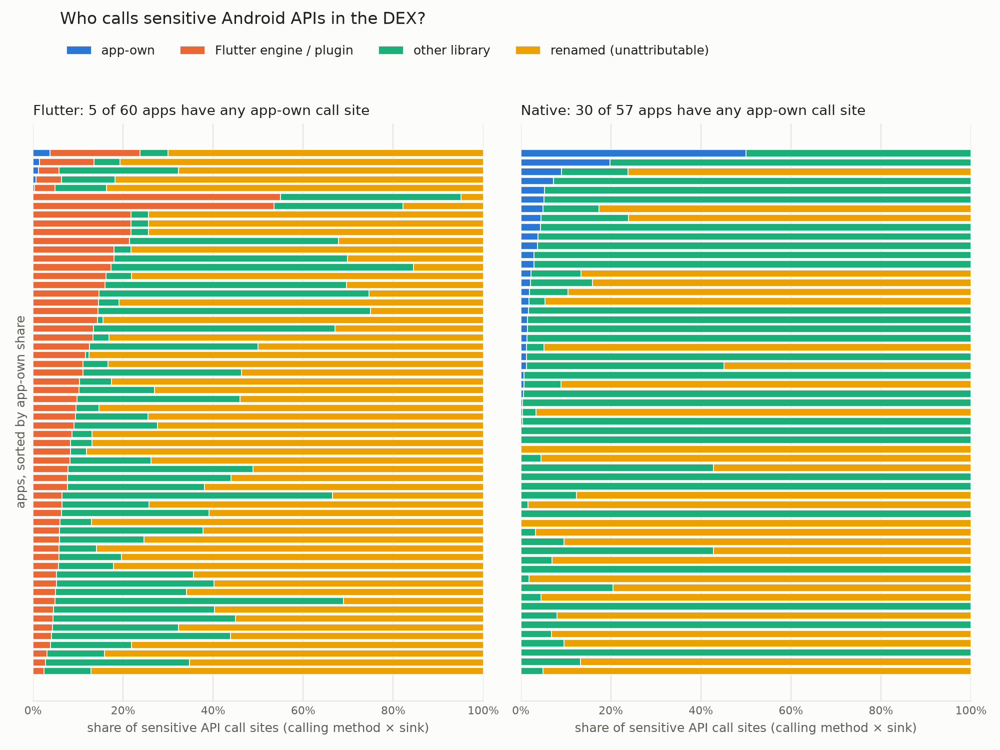
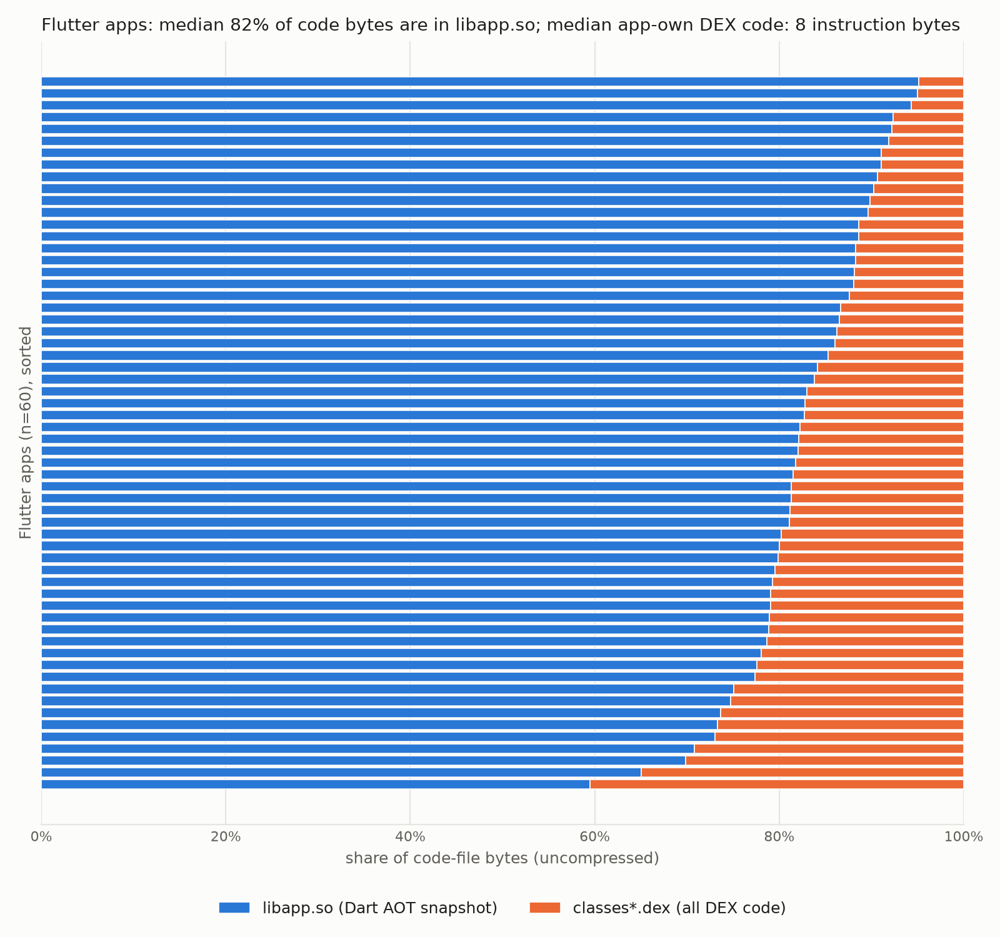

# The Flutter blind spot in DEX-based Android malware detection: pilot report

A small, reproducible pilot study. Every number below comes from a script output under
`results/`; the running decision log is `LOG.md`.

---

## Pilot B: the Flutter blind spot in DEX-based Android malware detection (benign apps only)

### 1. Question

Learning-based Android malware detectors mostly extract their features from DEX bytecode and the
manifest (Drebin-style: permissions, sensitive API calls, components, intents, URLs). Flutter apps
compile their Dart logic to a native AOT snapshot (`lib/<abi>/libapp.so`) instead of DEX.
**How much of a Flutter app's own behaviour is invisible to DEX-based features, and what do those
features see instead?**

Novelty check (`pilotB_flutter/00_novelty_check.md`): no paper found measures detector-feature
visibility for Flutter apps. The closest work runs existing static analysers (MobSF, FlowDroid) on
Flutter / React Native / Kotlin apps (Sterling et al., COMPSAC 2026, abstract only). A manual Google
Scholar pass is still pending.

### 2. Data and sampling

**Ground-truth pair** (`pilotB_flutter/testapp_flutter/`, `testapp_native/`,
`pilotB_flutter/ground_truth.json`). One Flutter app and one native Kotlin twin, each with five benign
behaviours behind buttons:
- B1: read the location;
- B2: count the contacts;
- B3: HTTPS POST to a fixed URL;
- B4: write and read a private file;
- B5: show a hard-coded dummy API key, masked.

The Flutter app uses the usual plugins: geolocator, flutter_contacts, http and path_provider. The
native twin uses platform APIs only.

Four release builds were analysed:

| Build | Configuration | APK bytes |
|---|---|---|
| `flutter_default` | `flutter build apk --release` | 45,184,907 |
| `flutter_obfuscated` | adds `--obfuscate --split-debug-info` | 43,136,907 |
| `native` | no R8, the Android template default | 657,056 |
| `native_r8` | R8 on, to mirror Flutter's default | 36,620 |

Toolchain: Flutter 3.41.2 / Dart 3.11.0, AGP 8.11.1. All 4 builds × 5 behaviours (20 of 20)
produced the expected output on a dedicated emulator (`results/pilotB/screens/`).

**Corpus** (`results/pilotB/corpus.csv`, `fdroid_snapshot.json`):
- **Source:** F-Droid (index of 4,923 packages, downloaded 2026-11-01), so every app is open source
  and benign.
- **Candidate classification:** F-Droid's own build recipes classify 529 apps as Flutter and 4,007 as
  native. 526 and 4,001 of them have an arm64-v8a-compatible APK.
- **Sample:** 60 Flutter + 60 native apps, seed 42.
  - Flutter: stratified by APK-size quartile, 15 per quartile.
  - Native: category quotas proportional to the Flutter pool's category mix.
  - Native apps were not size-matched: Flutter APKs are much larger (median 25.0 MB vs 5.5 MB), so
    size-matching would select atypically large native apps.
- **Framework confirmation from APK contents:**
  - Flutter = `libapp.so` + `libflutter.so`.
  - Native = no Flutter, React Native or Xamarin markers.
- **Exclusions: 0.** Every sampled APK matched its SHA-256 in the index and its expected framework
  (`excluded.csv` is header-only).
- **Download size:** 2.66 GB.

### 3. Method

**Features** (`pilotB_flutter/02_extract_features.py`, androguard 4.1.4, static only). Rules are in
`pilotB_flutter/attribution_rules.yaml`.
- **Drebin-style features:** permissions, hardware features, components, intent actions, DEX URLs, and
  sensitive call sites.
- **Sensitive call sites:** framework sinks in 11 categories (location, contacts, network, file,
  crypto, telephony, SMS, camera, microphone, reflection, dynamic loading), plus static reads of
  content-provider URI fields and `content://` strings.
- **`libapp.so` strings:** printable runs of at least 6 characters, as in `strings -n 6`.
- **Unit of count:** distinct (calling method, sink) pairs.

**Attribution** of each call site, by the name of the calling class:
- **app-own:** the app's package prefix, taken from the applicationId and its Application and launcher
  classes.
- **Flutter engine/plugin:** `io.flutter.*`, known plugin namespaces, and the plugin classes listed by
  each APK's `GeneratedPluginRegistrant`.
- **other library:** everything else that is named.
- **unattributable (renamed):** class names that R8 shortened to 1–2 characters, or moved into the
  default package.

R8 runs by default for Flutter release builds. It renames most classes, so attribution cannot be
read from names everywhere. Corpus results are therefore also reported separately for renamed and
non-renamed APKs. An APK counts as renamed if at least 50 % of its classes are renamed; this
threshold was fixed before the analysis, and 30 % and 70 % are also reported.

**Validation.**
- **Test pair:** call sites are de-obfuscated per method with the saved R8 mapping files. Per-method
  matters because R8 merges methods from unrelated classes into one class.
- **jadx spot-check** (`results/pilotB/spotcheck_sample.csv`):
  - **Sample (seed 42):** 5 Flutter and 5 native corpus APKs, covering renamed and non-renamed builds,
    with 8 call sites each (80 rows). In addition, all 14 call sites attributed to app-own code in
    Flutter apps.
  - **Each row checked:** is the sink really in the decompiled calling method, and whose code is it?
  - **Who judged:** John Wogu, reading jadx output, with an evidence note per row (initial
  verdicts were LLM-assisted; 25 were re-checked by John).

**Statistics** (`pilotB_flutter/03_analyze.py`).
- One value per APK; medians and IQRs.
- Two-sided Mann-Whitney U tests and Cliff's δ (negative = Flutter lower).
- Holm correction over the 5 primary metrics.
- All metric definitions were fixed in `LOG.md` before any Flutter-vs-native statistic was computed.

### 4. Results

#### 4.1 Ground-truth pair (`results/pilotB/test_pair_table.md`, `test_pair_summary.json`)

| Behaviour | native | native_r8 | flutter_default | flutter_obfuscated |
|---|---|---|---|---|
| B1 location | 2 calls, 2 app-own | 2 calls, 1 app-own (2 after de-obf.) | 4 calls, **0 app-own** (0 after de-obf.) | same as default |
| B2 contacts | 1 call, 1 app-own | 1 call, 1 app-own | 63 calls, **0 app-own** (0 after de-obf.) | same |
| B3 HTTPS POST | 3 calls, 2 app-own; URL in DEX | 2 calls, 2 app-own; URL in DEX | **no network call in DEX**; URL only in `libapp.so` | same |
| B4 private file | 25 calls, 1 app-own; file name in DEX | 3 calls, 1 app-own; file name in DEX | 11 calls, **0 app-own**; file name only in `libapp.so` | same |
| B5 dummy key | key in DEX | key in DEX | key only in `libapp.so` | key only in `libapp.so` |

"Calls" are distinct (calling method, sink) pairs. In the test-pair files they are listed as "caller
methods".

- **None of the four API-backed behaviours has an app-own call site in the Flutter DEX,** by name or
  after de-obfuscation.
  - Location and contacts are called only from plugin code (geolocator, flutter_contacts).
  - The file calls belong to the Flutter loader and an androidx library. path_provider calls Android
    from Dart through `package:jni` and has no Java code.
  - Networking happens in the engine's native code, so the DEX has no network sink at all.
- **The native twin has app-own call sites for B1–B4.** With R8 on, one native call moves into a
  renamed synthetic helper class, so it is attributable only through the mapping file.
- **All 3 dangerous permissions the Flutter app requests lack an app-own call site** (fine location,
  coarse location, contacts). The native app has 0 such permissions.
- **`--obfuscate` does not change the DEX at all** (byte-identical to the default build). In
  `libapp.so`:
  - size: 3,736,496 → 3,081,136 bytes;
  - printable strings: 10,746 → 5,037;
  - Dart package paths: 23 → 2;
  - the app's own `package:pilot_flutter/` path and method names disappear;
  - the URL, file name and dummy key survive.
- **App-own DEX instruction bytes:** 8 for Flutter (an empty `MainActivity`) vs 2,426 for native.

#### 4.2 Corpus, 60 Flutter vs 60 native (`results/pilotB/summary.json`)

| Metric (per APK, median [IQR]) | Flutter | Native | Holm p | Cliff's δ |
|---|---|---|---|---|
| App-own share of sensitive call sites | 0.000 [0.000–0.000] | 0.004 [0.000–0.021] | 1.9e-07 | −0.46 |
| App-own share of DEX instruction bytes | 0.000 [0.000–0.001] | 0.014 [0.006–0.046] | 1.0e-15 | −0.87 |
| Share of the app's URLs found in DEX strings | 0.000 [0.000–0.000], n = 48 | 1.000 [1.000–1.000], n = 43 | 7.8e-19 | −0.98 |
| App-own share of attributable Drebin features | 0.083 [0.055–0.119] | 0.205 [0.124–0.362] | 8.9e-11 | −0.70 |
| Dangerous permissions with no app-own call site | 1.0 [1.0–1.0], n = 25 | 1.0 [1.0–1.0], n = 17 | 0.065 | 0.19 |

- **Sensitive calls:** only **5 of 60** Flutter apps have any sensitive call site in their own code,
  against **30 of 57** native apps (3 native apps have no sensitive sinks at all). The 5 Flutter cases
  are genuine Kotlin/Java written by the app's authors, e.g. a location service. The difference holds
  in both strata:
  - renamed (50 Flutter / 28 native): p = 0.0014, δ = −0.31;
  - not renamed (10 / 32): p = 0.0011, δ = −0.66;
  - at the 70 % threshold: p = 0.025 and 8.0e-06;
  - at the 30 % threshold, only 3 Flutter apps count as not renamed, giving p = 0.054.
- **Where the code is:** a median of **82.2 %** [79.0–88.3] of a Flutter app's code-file bytes are in
  `libapp.so` (median 8.0 MB) rather than DEX (median 1.9 MB). The median app-own DEX code is 8
  instruction bytes, against 24,587 in native apps.
- **URLs:** 48 Flutter apps contain app-specific URLs, and **42** of them have those URLs only in
  `libapp.so`. Hosts that appear in at least 6 of the 120 apps count as common and are excluded. For
  native apps the share of 1.0 holds by construction, because they have no `libapp.so`.
- **Drebin features:** apps have about the same number of distinct Drebin-style features (48.5 vs
  55, p = 0.59). What differs is their origin: in Flutter apps, a median of 23.4 % of attributable
  features come from the Flutter engine or plugins. That code is shared by every app that uses those
  plugins.
- **Native apps' sensitive calls are mostly library code too.** Without R8, native apps ship all of
  androidx, and androidx code calls location, file and reflection APIs itself. The dangerous-permission
  metric therefore shows no Flutter-specific effect (p = 0.065). The contrast is "app-own code rarely
  makes the call" (native) vs "almost never" (Flutter).

**Figures:**

#### 4.3 Spot-check of the attribution (`results/pilotB/spotcheck_sample.csv`)

- The sensitive call was present in the decompiled method in 93 of 94 rows; jadx failed on one method.
- **58 of 61 named attributions were correct:**
  - random Flutter rows: 26/27;
  - random native rows: 18/20;
  - Flutter app-own rows: 14/14.
- 8 rows are ambiguous: a developer's own library shared across their apps. 1 row's origin could not
  be identified.
- **0 of 25 renamed call sites were app code:** 22 library, 2 Flutter engine/plugin, 1 unknown.
- **The 3 errors:**
  - Two came from a bundled `MultiDexApplication` being taken as app-own evidence. This is now fixed.
  - One was Flutter plugin-registration code that R8 merged into a class that kept a library package
    name. This cannot be fixed without mapping files.
- The spot-check also showed that R8 can put renamed classes in the default package with 3-character
  names. These now count as renamed.
- After both fixes, all features and statistics were re-computed. The numbers above are the
  re-computed ones; the first run is kept in `LOG.md`.

### 5. Threats to validity

- **Small corpus:** 60 + 60 apps from one store. Effect sizes are large, but the medians are not
  population estimates.
- **Open-source bias:** F-Droid apps have no commercial SDKs or packers and few ads or trackers. Real
  Play Store apps (and malware) may carry much more native-side library code.
- **Plugin attribution heuristics:**
  - The attribution is name-based.
  - R8 renaming makes 50 of 60 Flutter and 28 of 60 native APKs mostly unattributable by name.
  - R8 class merging can put plugin or app code inside a class that keeps a library name; 1 case
    in the spot-check.
  - The spot-check verdicts were first produced with LLM assistance (Claude) reading jadx output, with an evidence note recorded per row. I then independently re-checked 25 of the 94 rows without seeing the recorded verdicts and agreed on 25 (100%).
  - `libapp.so` was not decompiled (blutter was not attempted), so "app-specific code in
    `libapp.so`" is an upper bound: it also contains Flutter-framework and package Dart code.
- **Flutter version differences:** Flutter and Dart versions of the corpus apps were not recorded.
  Snapshot layout and obfuscation behaviour may vary between versions. The test pair uses Flutter
  3.41.2 only.
- **No malware:** the pilot measures what DEX features cannot see in benign apps. It does not show
  that a detector misses Flutter malware.
- **Metric definitions:**
  - Counts are (calling method, sink) pairs, not instruction-level call sites.
  - The sink list is a Drebin/PScout-style subset, not a full permission map.
  - "App URL" is defined by a host-frequency cut-off (fewer than 6 of 120 apps).

### 6. What a full study would add

- A larger corpus from Google Play (e.g. AndroZoo), with Flutter version stratification and plugin
  attribution validated against `pubspec.lock` where source is available.
- Recovery of Dart-level behaviour from `libapp.so` (blutter, AOTopsy, or Dart snapshot parsing), to
  measure how much of the blind spot a Dart-aware extractor closes.
- Retraining and evaluating existing detectors (e.g. the tools benchmarked by Tegegn & Rubin, ISSTA
  2026) on Flutter apps, including Flutter malware samples, which this pilot deliberately does not
  touch.
- An independent human rater for the attribution spot-check, with inter-rater agreement.

---

## Quotable results

> - In a matched Flutter/native test app with five benign behaviours, none of the four API-backed
>   behaviours (location, contacts, HTTPS POST, private file) has a call site in the Flutter app's own
>   DEX code, even after de-obfuscation with the R8 mapping file. The native twin has app-own call
>   sites for all four. (`results/pilotB/test_pair_table.csv`)
> - In 60 open-source Flutter apps from F-Droid, a median of 82.2 % of code bytes are in the Dart
>   snapshot `libapp.so` rather than DEX, and only 5 of 60 apps have any sensitive Android API call in
>   their own DEX code, against 30 of 57 comparable native apps.
>   (`results/pilotB/summary.json`)
> - 42 of the 48 Flutter apps with app-specific URLs contain those URLs only in `libapp.so`, where
>   DEX-based string features never look. (`results/pilotB/summary.json`)
> - Flutter and native apps expose about the same number of Drebin-style features (median 48.5 vs 55),
>   but in Flutter apps a median of 23.4 % of the attributable features come from the Flutter engine
>   or plugins, code shared by every app that uses them. (`results/pilotB/summary.json`)
> - Dart `--obfuscate` leaves the DEX byte-identical and only shrinks `libapp.so` (10,746 → 5,037
>   printable strings), while URLs and hard-coded keys survive in plain text.
>   (`results/pilotB/test_pair_summary.json`)
